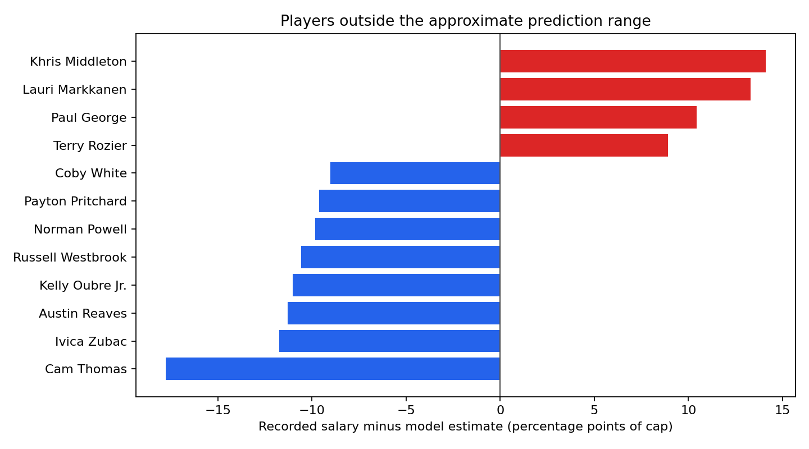

# NBA Player Compensation and On-Court Impact Analysis
## Practical findings and decision implications

### Executive summary

We expanded the original salary prediction project into a longer-term, cap-adjusted analysis of player compensation and on-court impact. The model combines prior-season statistics and OpenRAPM impact ratings with age and experience, compares salary as a share of the league cap, and benchmarks players against learned statistical-role and experience cohorts.

On a held-out 2025–26 season, a Random Forest model reduced mean absolute salary error by **59%** versus a training-median baseline. It explained **84% of the variation in salary-cap share** in that test set. A calibrated range flagged 32 of 434 players for closer review. These results support using the model to prioritize investigation; they do not determine whether a contract is fair.

### Analysis design

The expanded dataset contains **4,578 player-season observations** spanning salary seasons 2015–16 through 2025–26. Player statistics and impact ratings from one season are matched to salary in the following season. Salary is expressed as a percentage of that season's cap to make comparisons across years more meaningful. Player IDs are used for joins, and salary rows across teams are combined for a player-season.

Ridge regression and Random Forest were compared using expanding, season-based validation. Random Forest had the lower average error in that validation and was selected for the final analysis. The final holdout includes **434 players from 2025–26**; model training includes **4,144 earlier observations**. An approximate prediction range was calibrated using the preceding season. **92.6%** of the holdout salaries fell inside the range, close to the nominal 90% level, though coverage from one season is not a guarantee for future seasons.

### Holdout model performance

| Model | MAE | RMSE | MAE as cap share | R² on cap share |
|---|---:|---:|---:|---:|
| Random Forest (selected) | $3.92M | $5.49M | 2.53 percentage points | 0.844 |
| Ridge regression | $5.19M | $6.90M | 3.35 percentage points | 0.754 |
| Training-median baseline | $9.66M | $15.05M | 6.25 percentage points | −0.173 |

### What the player comparisons show

For each player, the model compares recorded salary with a performance-based estimate and a broad prediction range. It also reports the median cap share for players in a similar learned statistical-role group and experience band. Players outside the range are review candidates.

For example, **Paul George** and **Khris Middleton** had recorded 2025–26 salaries above the model's approximate ranges. **Cam Thomas** and **Ivica Zubac** had recorded salaries below their model ranges. These are useful prompts: check the contract structure, playing context, role, health, or other omitted factors. They are not labels of “overpaid” or “underpaid.”

### Impact and compensation

OpenRAPM provides an additional impact estimate, including wins over an average starter (WOSA). The project reports that metric alongside salary and also produces a descriptive impact-per-cap-share shortlist. It does not convert wins into dollars or claim a financial return on investment; doing so would require a separate, well-supported estimate of the economic value of a win.

The project also generates an **AI research brief**: a copy-ready prompt with model evidence cards for a web-enabled research assistant to check contract terms, extensions, awards, injuries, and team context using linked sources. The project does not call a generative AI service or present generated context as verified fact.

### Recommended use

Use the model to identify players whose pay differs materially from a context-aware statistical estimate, then investigate why. Before making a business judgment, verify contract details and compare the player with relevant peers. The next modeling improvement would be to add contract options, guaranteed money, years remaining, awards, injury history, team needs, and other salary-setting factors, then test across more future seasons.

### Limitations

- “Expected salary” is a statistical prediction, not a counterfactual fair-market price.
- The six role groups are learned from statistical profiles; they are not official positions or scouting archetypes.
- The approximate prediction band is calibrated on one season and may be too narrow or wide after a league-wide shift.
- OpenRAPM and WOSA are estimates, not direct observations of player value; historical ratings can be recomputed.
- Salary data can include obligations paid by multiple teams after a trade or buyout and may differ from contract cash flow.
- The analysis omits contract status, options, guaranteed money, team context, market size, awards, and detailed injury information.

### Bottom line

The expanded project is a more credible **screening and peer-comparison tool** than the original salary-only model. It combines time-aware validation, cap-adjusted pay, player-impact estimates, learned role groups, and uncertainty ranges. Its strongest use is to frame better questions and direct research—not to make a standalone contract recommendation.
